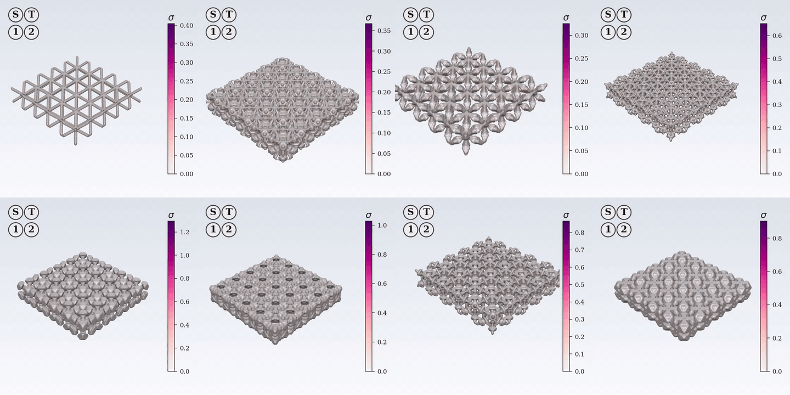
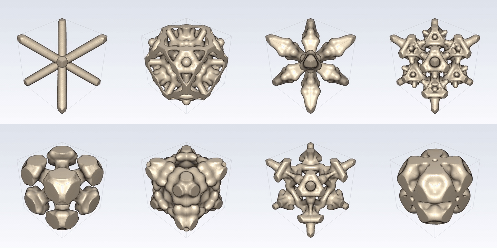

# LEIA
Haiqian Yang, Yuan Cao, Markus J. Buehler

The paper is on [arXiv](https://arxiv.org/abs/2605.28368) and accepted at NeurIPS 2026 ([citation](#citation)).

## Overview
**LEIA** is a learned environment for engineering architected materials: apply boundary conditions step by step and observe the resulting deformation and stress fields in real time on three-dimensional unstructured meshes (71K–442K nodes, autoregressive).

LEIA tokenizes displacement fields on tetrahedral meshes via Perceiver cross-attention, predicts dynamics under user-controlled boundary conditions via an action-conditioned transformer, and reads out Cauchy stress via a universal stress head (accurate across Neo-Hookean and viscoelastic regimes). End-to-end pipeline:

```
mesh ──► PerceiverTokenizer.encode ──► K continuous latents
       ──► AdaLNContinuousDynamicsTransformer(tokens, action_4dof) ──► next tokens
       ──► PerceiverTokenizer.decode ──► displacement
                                    └─► stress head ──► Cauchy stress
```



*Production LEIA rolling out eight MicroPlate lattices under independent boundary conditions. The four buttons in each panel encode the per-step action — `S` stretch, `T` twist, `1` shear-y, `2` shear-z — with state* `+1` *(blue, loading),* `0` *(gray, hold), or* `−1` *(orange, unloading). Mesh color is von Mises stress* (`σ`) *with per-panel normalization.*



*The eight underlying unit cells, rotating. Each plate is a* `(5, 5, 1)` *tiling of the cell shown.*

These eight plates are drawn from **MicroPlate**, the benchmark released with this code. Two regimes: (1) architected lattices with explicit 3D microstructure (63 topologies, 71K–442K mesh nodes); (2) a homogeneous viscoelastic plate where microstructure is captured implicitly via internal state.

## Install

```bash
conda env create -f environment.yml           # PyTorch + FEniCS (dolfin 2019.1): meshing, lattice FEM, training, eval
conda activate leia
conda env config vars set LD_LIBRARY_PATH=$CONDA_PREFIX/lib   # one-time, stored in the env; see note below
conda deactivate && conda activate leia                       # a fresh activation exports it (re-activating the active env does not)
pip install -e .                              # editable: leia reads data/manifests/ from the repo
bash tests/smoke_e2e.sh                       # optional sanity check: `import leia` + every scripts/*.py --help

conda env create -f environment-fenicsx.yml   # FEniCSx (dolfinx 0.8): MicroPlate visco FEM only
# System tools (apt/yum): xvfb and ffmpeg — used by tests/preview_*.sh, the render scripts
# and the design_search figure orchestrators for headless rendering and video.
```

Run every command in this README from the repository root: `pip install -e .`
installs only the `leia` package, while `physics/`, `data_curation/` and
`design_search/` are imported relative to the repo (the scripts put it on
`sys.path`). The training commands pass `--wandb`; run `wandb login` once, set
`WANDB_MODE=offline`, or drop the flag.

The `LD_LIBRARY_PATH` line makes the `leia` env use its own libstdc++: PyTorch is
a pip wheel that loads the host's copy, while conda-forge's dolfin and h5py need a
newer one, so on hosts with an older system libstdc++ (Ubuntu 22.04, RHEL 8/9)
they fail to import after torch without it. conda exports the variable on
activation (replacing any you had) and removes it on deactivation. The `fenicsx`
env needs nothing.

No bulk artifacts are hosted. The repo ships the 63 plate graphs and the split
manifests under `data/`; meshes, FEM trajectories, caches, and checkpoints are
all built locally by the steps below. Expected on-disk layout and sizes:
[data/README.md](data/README.md).

## 1. Build the MicroPlate dataset

CPU-heavy: the paper's data was generated with 100–200 parallel FEM workers.
Pipeline details in [data_curation/README.md](data_curation/README.md).

Everything from here on runs in the `leia` env (`conda activate leia`). The one
exception is the visco FEM solver, which runs in `fenicsx`; its block switches
envs explicitly.

### Meshes (needs a CUDA GPU for the SDF kernel)

```bash
python data_curation/mesh/build_meshes.py --all      # 63 plates → data/meshes/microplate_lattice/mg_*/mesh.npz
```

### Lattice FEM

```bash
PYTHONHASHSEED=0 python data_curation/fem/run_plate_fem.py \
    --n-meshes 0 --trajs-per-mesh 500 --target-converged 110 \
    --mu 1.0 --lmbda 10.0 \
    --workers 100 \
    --output-dir data/microplate_lattice                # → data/microplate_lattice/npz/mg_*/traj_NNN.npz
```

Training and evaluation split each plate's trajectories by sorted index: the
first 100 train, the rest are in-distribution validation (`training_cutoff_index`
in `data/manifests/microplate_lattice_indist_val_trajs.json`), so every training
plate needs **at least 101 converged trajectories**. Newton divergence rates vary
widely by topology, so the command attempts up to 500 per plate and
`--target-converged 110` stops dispatching for a plate once it has enough.
`--n-meshes 0` covers all 63 plates, held-out ones included. `--workers` is the
number of parallel FEM processes (one BLAS thread each). Already-written
trajectories are skipped, so re-running tops up. `PYTHONHASHSEED=0` is
required: trajectory seeds derive from the plate name's hash, which Python
randomises per process otherwise, and the paper's data was built with it.

### Visco FEM, then package

```bash
conda activate fenicsx
python data_curation/fem/run_visco_load_reverse.py fem --batch 1100 --workers 100

conda activate leia
python data_curation/fem/run_visco_load_reverse.py build-hdf5 \
    --source-dir data/visco_load_reverse_production \
    --output-h5 data/microplate_visco/microplate_visco.h5 \
    --split-json data/manifests/microplate_visco_splits.json
```

`build-hdf5` packs the first 1,000 converged seeds in seed order and rewrites
the committed split file with a seeded 800/100/100 permutation. Divergence is
deterministic and some seeds below 1,000 diverge, so attempting 1,100 reproduces
the paper's pool and the committed split exactly.

## 2. Precompute caches

Pure derivatives of the FEM core, built once (a few hours, multi-CPU).

```bash
python scripts/precompute_fps.py    --npz-dir data/microplate_lattice/npz \
                                    --output-dir data/microplate_lattice/fps   # every plate, held-out ones too: evals subsample with it
python scripts/precompute_grad_u.py --npz-dir data/microplate_lattice/npz \
                                    --mesh-dir data/meshes/microplate_lattice \
                                    --plate-list data/manifests/microplate_lattice_production_plates_v2.json \
                                    --max-trajs 101 \
                                    --output-dir data/microplate_lattice/grad_u   # 100 training + the first val trajectory (§ 4 e2e eval)
python scripts/build_tokenizer_mmap.py \
    --npz-dir data/microplate_lattice/npz \
    --fps-dir data/microplate_lattice/fps \
    --grad-u-dir data/microplate_lattice/grad_u \
    --plate-list data/manifests/microplate_lattice_production_plates_v2.json \
    --output-dir data/microplate_lattice/plate_dataset_curated_mmap_100k

python scripts/precompute_tet_geom.py \
    --mesh-dir data/meshes/microplate_lattice \
    --mmap-dir data/microplate_lattice/plate_dataset_curated_mmap_100k \
    --plate-list data/manifests/microplate_lattice_production_plates_v2.json \
    --output-dir data/microplate_lattice/plate_tet_geom
```

`precompute_tet_geom` is only needed for ablation row 2 (tet Sobolev; see
[docs/ablations.md](docs/ablations.md)). It restricts each plate's tets to the
curated node set the tokenizer trains on, which it reads from the tokenizer
mmap, so it runs after `build_tokenizer_mmap.py`.

## 3. Train

8×H100 production setup: ~2.5 days end-to-end for the lattice models, ~12 hours
for visco. Hyperparameters are pinned per paper checkpoint in [`configs/`](configs/).

### Lattice tokenizer (~13 hours)

```bash
bash scripts/launch.sh train-tokenizer --gpus 8 --run-name v2-tok -- \
    --mmap-dir data/microplate_lattice/plate_dataset_curated_mmap_100k \
    --subsample-n 10240 --fps-core-n 8192 \
    --num-latents 512 --hidden-dim 1024 --num-encoder-layers 6 --num-decoder-layers 0 \
    --n-input-frames 3 --stress-head \
    --cauchy-stress-weight 1.0 --cauchy-stress-warmup-steps 31000 \
    --batch-size 8 --accum-steps 2 --lr 1e-4 --weight-decay 1e-5 \
    --max-steps 100000 --val-interval 1000 --checkpoint-interval 5000 \
    --lr-schedule cosine --bf16 --wandb
```

### Lattice dynamics (~2 days)

```bash
# Every encode step (tokenizer training above, this mmap, the evals in § 4) uses the
# paper's subsample: 8192 FPS-core nodes + 2048 random ones. The scripts default to it.
python scripts/build_dynamics_mmap.py \
    --tokenizer checkpoints/tokenizer/v2-tok_*/best.pt \
    --npz-dir data/microplate_lattice/npz \
    --fps-dir data/microplate_lattice/fps \
    --curated-plates data/manifests/microplate_lattice_production_plates_v2.json \
    --subsample-n 10240 --fps-core-n 8192 \
    --output-mmap-dir data/microplate_lattice/structure_tokens_prod_mmap

bash scripts/launch.sh train-dynamics --gpus 8 --run-name v2-dyn -- \
    --tokenizer-checkpoint checkpoints/tokenizer/v2-tok_*/best.pt \
    --mmap-dir data/microplate_lattice/structure_tokens_prod_mmap \
    --method continuous_pf --rollout-steps 10 --velocity-input \
    --noise-std 0.02 --dropout 0.3 --batch-size 8 \
    --lr 1e-4 --weight-decay 1e-4 --epochs 300 \
    --warmup-epochs 10 --lr-schedule cosine --bf16 \
    --ar-eval-trajs 5 --ar-eval-interval 1 --checkpoint-interval 10 --wandb
```

Every epoch checkpoint carries optimizer state (~2.5 GB for this model), so
`--checkpoint-interval 10` keeps 30 of them (~75 GB) over the 300 epochs; the
default of 1 would write ~0.75 TB. `best.pt` and `best_ar.pt` are saved without
optimizer state (~0.8 GB each).

### MicroPlate visco (~12 hours)

```bash
bash scripts/launch.sh train-tokenizer --gpus 8 --run-name visco-tok -- \
    --visco-load-reverse-data data/microplate_visco/microplate_visco.h5 \
    --splits-json data/manifests/microplate_visco_splits.json \
    --num-latents 256 --hidden-dim 256 \
    --num-encoder-layers 8 --num-decoder-layers 4 \
    --n-input-frames 3 --stress-head \
    --cauchy-stress-weight 1.0 --batch-size 64 \
    --lr 3e-4 --max-steps 30000 --val-interval 500 --checkpoint-interval 1000 \
    --bf16 --wandb

# Use best_recon.pt (recon-only selector), not best.pt: on visco the combined-loss
# best.pt saturates early on a stress local minimum. best_recon.pt matches the paper run.
python scripts/build_microplate_visco_mmap.py \
    --tokenizer-checkpoint checkpoints/tokenizer/visco-tok_*/best_recon.pt \
    --h5-path data/microplate_visco/microplate_visco.h5 \
    --splits-json data/manifests/microplate_visco_splits.json \
    --output-train-dir data/microplate_visco/dynamics_mmap/train \
    --output-val-dir data/microplate_visco/dynamics_mmap/val

bash scripts/launch.sh train-dynamics --gpus 8 --run-name visco-dyn -- \
    --tokenizer-checkpoint checkpoints/tokenizer/visco-tok_*/best_recon.pt \
    --mmap-dir     data/microplate_visco/dynamics_mmap/train \
    --mmap-dir-val data/microplate_visco/dynamics_mmap/val \
    --method continuous_pf --rollout-steps 20 --velocity-input \
    --noise-std 0.0 \
    --batch-size 32 --lr 3e-4 --weight-decay 1e-4 --epochs 300 \
    --bf16 --ar-eval-trajs 5 --checkpoint-interval 10 --wandb
```

## 4. Evaluate

Eval, `tests/`, and `design_search/` read the lattice checkpoints from the
`production_v2` slot, one symlink per model. Choose the runs to serve: within a
run the trainers already keep the best checkpoint (`best.pt` by validation
loss, `best_ar.pt` by AR-rollout error on the last few trajectories of the
first training plate, a rollout-stability proxy rather than a held-out metric);
across runs, compare their logged metrics. Then promote them
with `scripts/promote.sh`, which checks the checkpoints exist and refuses to
overwrite a real directory. Results land in `outputs/`. The `*-tok_*` /
`*-dyn_*` globs in these commands assume one run per name; with more, spell
out the run directory.

```bash
# Promote the chosen runs into the served slot (symlinks; re-run to switch)
bash scripts/promote.sh \
    checkpoints/tokenizer/v2-tok_<timestamp> \
    checkpoints/dynamics/v2-dyn_<timestamp>

# MicroPlate lattice — Table 1 row 6 (stress head; reconstruction on the training mmap), Fig 3 (AR rollout + F-D), appendix GT F-D (~hours)
python scripts/eval.py tokenizer \
    --checkpoint checkpoints/tokenizer/production_v2/best.pt \
    --mmap-dir   data/microplate_lattice/plate_dataset_curated_mmap_100k \
    --n-frames 100 \
    --subsample-n 10240 --fps-core-n 8192 \
    --stress-mu 1.0 --stress-lmbda 10.0 \
    --output-dir outputs/leia_lattice/stress
python scripts/eval.py e2e \
    --tokenizer checkpoints/tokenizer/production_v2/best.pt \
    --dynamics  checkpoints/dynamics/production_v2/best_ar.pt \
    --npz-dir       data/microplate_lattice/npz \
    --fps-dir       data/microplate_lattice/fps \
    --grad-u-dir    data/microplate_lattice/grad_u \
    --curated-plates data/manifests/microplate_lattice_production_plates_v2.json \
    --mesh-dir      data/meshes/microplate_lattice \
    --max-trajs 101 --traj-indices "100" \
    --subsample-n 10240 --fps-core-n 8192 \
    --stress-mu 1.0 --stress-lmbda 10.0 \
    --full-mesh --compute-fd \
    --output-dir outputs/leia_lattice/dynamics
python scripts/eval.py gt-fd \
    --npz-dir  data/microplate_lattice/npz \
    --mesh-dir data/meshes/microplate_lattice \
    --curated-plates data/manifests/microplate_lattice_production_plates_v2.json \
    --max-trajs 1 \
    --mu 1.0 --lmbda 10.0 \
    --output outputs/leia_lattice/fd_curves_gt.h5

# MicroPlate visco — Table 2 LEIA row (~1 hour)
python scripts/eval_microplate_visco.py \
    --tokenizer-checkpoint checkpoints/tokenizer/visco-tok_*/best_recon.pt \
    --dynamics-checkpoint  checkpoints/dynamics/visco-dyn_*/best_ar.pt \
    --h5-path data/microplate_visco/microplate_visco.h5 \
    --splits-json data/manifests/microplate_visco_splits.json \
    --split test \
    --output-dir outputs/leia_visco
```

Quick regression checks (seconds to minutes) live in [`tests/`](tests/README.md);
`bash tests/release_qualify.sh` runs all of them.

## 5. Design search

`design_search/` uses the `production_v2` checkpoints as a fast surrogate for
design. The engine (`design_search.core`) meshes a candidate lattice, encodes
it, rolls it out under stretch and shear loading, and scores mechanical
anisotropy — hard to stretch, easy to shear, at low volume fraction. The beam
search (`design_search.beam`, paper §5.3) mutates topologies, keeps the top
B children of each iteration (non-elitist), and reports the best design of the
whole run as the winner. CLI defaults are the paper configuration (seed plate `mg_046`, B=5, K=8,
D=10, 20 steps per direction). K is nominal: the search generates 1.5 K mutants
per parent to absorb mesh failures and evaluates every one that meshes, up to
12 for K=8, as the paper's runs did.

```bash
# Beam search (~30 min on 1 GPU) → design_search/outputs/beam_001/results.json
python -m design_search.beam.search --output-dir design_search/outputs/beam_001

# FEM ground truth on the best candidate per iteration (~16 min, multi-CPU)
python -m design_search.beam.fem_validate \
    --beam-results design_search/outputs/beam_001/results.json \
    --output-dir   design_search/outputs/beam_001/fem
```

Per-stage CLIs, including the OOD-confidence landscape and learned confidence
head (paper §5.4), are in [design_search/README.md](design_search/README.md).
The paper-figure orchestrators (Fig 4: beam search; Fig 5: OOD landscape, 15
stages on 8 GPUs) live in [`design_search/repro/`](design_search/repro/).

Table 1 ablation rows (training + eval recipe): [docs/ablations.md](docs/ablations.md).

## Repo layout

| Directory        | Purpose                                                                     |
| ---------------- | --------------------------------------------------------------------------- |
| `leia/`          | Importable Python package — models, datasets, losses, training, metrics     |
| `physics/`       | Mesh and FEM utilities (graph→tet meshing API; FEniCS / FEniCSx drivers)    |
| `scripts/`       | Thin CLI wrappers around `leia/` and `physics/`; `render_*.py` make videos  |
| `data_curation/` | FEM ground-truth generation pipelines                                       |
| `design_search/` | Figure 4 (design search) + Figure 5 (OOD landscape) pipelines               |
| `configs/`       | Pinned hyperparams for paper checkpoints                                    |
| `data/`          | Manifests + plate graphs (committed); bulk artifacts built via `data_curation/` |
| `assets/`        | README media (gallery GIFs from `scripts/render_microplate_gallery.py`)     |
| `docs/`          | Architecture, datasets, ablations, pitfalls                                 |
| `tests/`         | Shell smokes (`smoke_*`) and previews (`preview_*`) — seconds to minutes    |


Further reading: [docs/architecture.md](docs/architecture.md) (model + pipeline), [docs/ablations.md](docs/ablations.md) (Table 1 ablation recipe), [docs/datasets.md](docs/datasets.md) (dataset specs and on-disk layout), [docs/pitfalls.md](docs/pitfalls.md) (material constants and other invariants).

## Citation

Accepted at NeurIPS 2026.

```bibtex
@article{yang2026leia,
  title={LEIA: Learned Environment for Interactive Architected Materials},
  author={Yang, Haiqian and Cao, Yuan and Buehler, Markus J},
  journal={arXiv preprint arXiv:2605.28368},
  year={2026}
}
```
